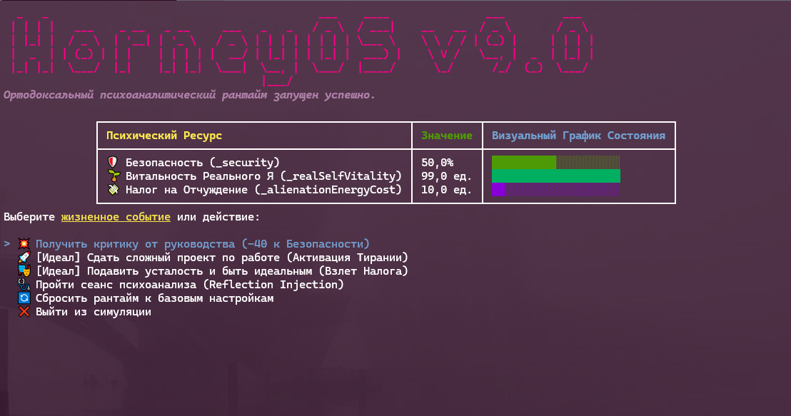

# 🧠 HorneyOS v9.0

> **HorneyOS** — экспериментальный рантайм на платформе **.NET 9.0** и **C# 13**, реализующий ортодоксальное моделирование психоаналитической теории Карен Хорни через призму строгого объектно-ориентированного программирования.

Проект визуализирует внутреннюю динамику невротической личности, борьбу Реального Я (Real Self) с Идеализированным образом, тиранию должествования и векторы психологической защиты в реальном времени с помощью библиотеки **Spectre.Console**.

---

## 🔬 Теоретический Фундамент и Архитектура

В отличие от классических фрейдовских моделей, оперирующих распределением либидо, архитектура HorneyOS полностью очищена от биологического детерминизма и построена на динамике **базальной тревоги** и **поиска безопасности**.

### Ключевые Метрики Системы (State Ресурсы)

* `_security` — уровень психологической безопасности. Обратная величина базальной тревоги. Если падает ниже 20%, ядро генерирует критический сбой.
* `_realSelfVitality` — жизненная сила и спонтанность Реального Я. Топливо подлинного существования системы, безжалостно выжигаемое невротическими механизмами.
* `_alienationEnergyCost` — налог на отчуждение. Хронические энергетические затраты рантайма на поддержание маски Идеализированного Я и подавление подлинных импульсов Реального Я. Растет при вмешательстве Тирании «Должен» и **каждый системный тик пассивно выжигает `_realSelfVitality`**.

### Анатомия Кодовой Базы

* **`NeuroticMind.cs`** — Ядро психики. Инкапсулирует приватные ресурсы и координирует жизненные события через кастомный делегат `IdealActionDelegate` (с поддержкой модификаторов `ref` для динамического изменения состояния).
* **`IIdealizedSelf.cs`** — Контракт Идеализированного Я. Требует немедленного развертывания идеального образа (`DeployPerfectProject`) и тотального подавления любых уязвимостей (`SuppressAllWeakness`).
* **`ShouldsTyrannyDecorator.cs`** — Через методы `DeployPerfectProject` и `SuppressAllWeakness` он временно накачивает систему мнимой безопасностью, взамен накладывая штрафы на `ref double realSelfVitality` и **навсегда повышая `_alienationEnergyCost`**
* **`NeuroticPrideValidator.cs`** *(В разработке)* — Валидатор Невротической Гордости. Блокирует попытки терапевтического вмешательства, защищая хрупкую структуру от изменений.
* **`Psychoanalyst.cs`** — Инструмент интервенции. Использует `System.Reflection`, чтобы обойти инкапсуляцию .NET, пробиться к приватным полям `NeuroticMind` и восстановить ресурсы Реального Я.

---

## 🛡️ Паттерн Strategy: Векторы Защиты (`ICopingStrategy`)

При росте базальной тревоги ядро активирует одну из трех ортодоксальных стратегий защиты:

| Стратегия | Класс | Поведенческий паттерн в коде | Трейд-офф |
| :--- | :--- | :--- | :--- |
| **К людям** *(Moving Toward)* | `MovingTowardPeople.cs` | Уступчивость, покупка безопасности ценой стирания собственных границ и интерфейсов. | Стирание идентичности |
| **Против людей** *(Moving Against)* | `MovingAgainstPeople.cs` | Агрессивная стратегия. Включает внутренний счетчик эксплуатации чужих ресурсов и триггер `[ПАРАНОЙЯ]`. | Рост враждебности |
| **От людей** *(Moving Away)* | `MovingAwayFromPeople.cs` | Обособление. Включает ментальный файрвол и переводит систему в режим глубокого анабиоза. | Полная изоляция |

---

## 🛠️ Стек технологий

* **Runtime:** .NET 9.0 (Оптимизированные структуры данных, современные паттерны)
* **Language:** C# 13 (Активное использование `ref fields`, `interceptors` для тирании «Должен»)
* **UI/CLI:** `Spectre.Console` — интерактивный рантайм-дашборд с бесконечным циклом `while(true)`, экранированием разметки (`Markup.Escape`) и разрешением конфликтов имен `Color`/`Rule`.

---

## 🚨 Критические Исключения

* **`BasicAnxietyException`** — Хронический сбой системы. Выбрасывается автоматически, когда уровень `_security` падает ниже критической отметки в 20%. Если вовремя не применить `Psychoanalyst`, рантайм падает в необратимый экзистенциальный `Crash`.

---

## 🏃‍♂️ Быстрый запуск

Выполните клонирование репозитория и запустите бесконечный цикл невроза:

```bash
dotnet run --project src/HorneyOS.csproj
```

> **Внимание:** При работе с дашбордом Spectre.Console убедитесь, что ваш терминал поддерживает TrueColor, иначе градиенты базальной тревоги отобразятся некорректно.

